# Banyira

Banyira is a peer-to-peer financing marketplace for small and medium businesses in Malawi. Businesses apply for financing, Banyira's credit team assesses them, approved businesses are listed, and investors make offers to fund them. Banyira then manages the agreement, disbursement, repayments and the ledger until the financing is repaid.

> Investing through Banyira involves risk. Credit assessments and risk classes support decisions; they do not guarantee repayment.

**Contents:** [Run it on your computer](#run-banyira-on-your-computer-step-by-step) · [Screenshots](#screenshots) · [How it works](#who-uses-it) · [For developers](#run-it-locally-windows--laragon)

---

## Run Banyira on your computer (step by step)

No programming experience needed. This takes about 20–30 minutes the first time, mostly waiting for downloads. The steps are for **Windows**.

Everything runs on your own computer. The app uses demo data and a pretend payment system, so **no real money and no real text messages** are involved.

### Step 1 — Install two programs (one time only)

1. **Laragon** — a free bundle that contains everything the app needs to run (PHP, a MySQL database and Composer).
   Download **Laragon Full** from <https://laragon.org/download/> and install it with the default options.
2. **Node.js** — used once to prepare the screens.
   Download the **LTS** version from <https://nodejs.org/> and install it with the default options.

### Step 2 — Download Banyira

1. Download this ZIP file: <https://github.com/Tama011-Tc/banyira-new-touch/archive/refs/heads/feat/theme-toggle-lazy-loading.zip>
   (you must be signed in to GitHub with an account that has access to this repository).
2. Right-click the downloaded ZIP → **Extract All…** → extract it to `C:\laragon\www`.
3. Rename the extracted folder to `banyira`, so you have `C:\laragon\www\banyira`.

### Step 3 — Start Laragon

Open **Laragon** and click **Start All**. Wait until it shows that Apache and MySQL are running. Leave Laragon open.

### Step 4 — Set up the app (one time only)

1. In Laragon, click **Terminal**. A black command window opens.
2. Copy each line below, paste it into that window (right-click pastes), press **Enter**, and wait for it to finish before the next one. Some lines take a few minutes and print a lot of text; that is normal.

```
cd C:\laragon\www\banyira
composer install
npm install
copy .env.example .env
php artisan key:generate
mysql -u root -e "CREATE DATABASE IF NOT EXISTS banyira4"
php artisan migrate --seed
npm run build
```

### Step 5 — Open Banyira

In the same window, type this and press **Enter**:

```
php artisan serve
```

Now open your web browser and go to **<http://localhost:8000>**. Keep the black window open while you use the app; closing it stops Banyira.

### Step 6 — Sign in with a demo account

| You want to see… | Click **Login**, choose | Email | Password |
|---|---|---|---|
| A business with offers waiting | Business | `owner@mzuzufresh.example` | `demo1234` |
| A business that is repaying | Business | `owner@lilongweprint.example` | `demo1234` |
| An investor's portfolio | Investor | `investor@example.com` | `demo1234` |

Staff accounts (credit, finance, sales, IT, executive) sign in at <http://localhost:8000/internal-access>; they are listed in [AGENTS.md](AGENTS.md) and need an authenticator app the first time.

Light or dark look: use the sun/moon button at the top right, or **Appearance** at the bottom of the page.

### Next time

Open Laragon → **Start All** → **Terminal**, then:

```
cd C:\laragon\www\banyira
php artisan serve
```

and open <http://localhost:8000>.

### If something goes wrong

| What you see | What to do |
|---|---|
| `No connection could be made…` or `Connection refused` | Laragon is not started. Click **Start All** and try again. |
| `'php' / 'composer' / 'mysql' is not recognized` | Use the **Terminal** button inside Laragon, not the normal Windows command prompt. |
| `'npm' is not recognized` | Node.js is not installed, or Laragon was open while you installed it. Install Node.js, then close and reopen Laragon. |
| `Failed to listen on 127.0.0.1:8000` | Something else is using that address. Run `php artisan serve --port=8001` and open <http://localhost:8001>. |
| The page looks unstyled or blank | Run `npm run build` again, then refresh the browser with **Ctrl+F5**. |
| You want to start over with fresh demo data | Run `php artisan migrate:fresh --seed` (this deletes everything you created in the app). |

---

## Screenshots

All screenshots use the demo data above.

### Public website

| | |
|---|---|
| **Home page**<br>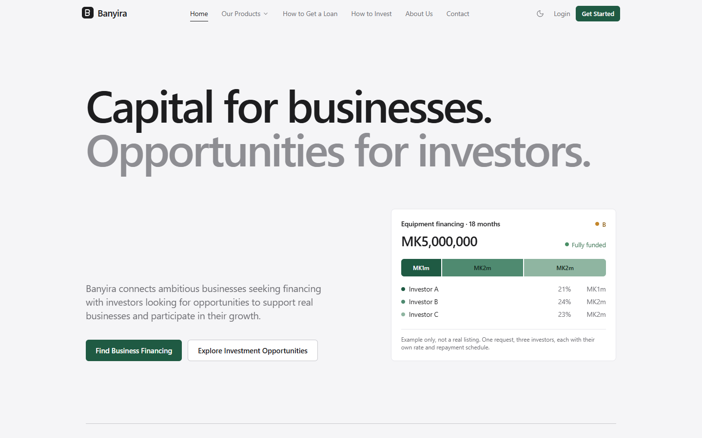 | **Home page in dark mode**<br>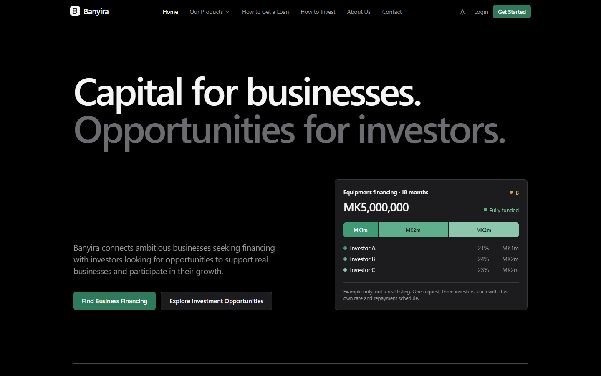 |
| **How money is protected** (home page)<br>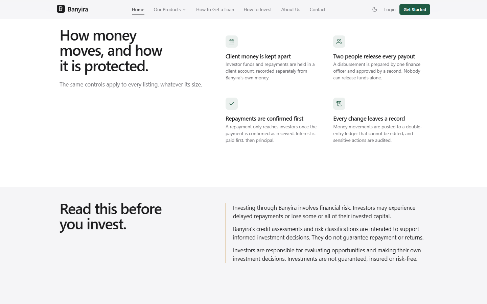 | **Financing products and fees**<br>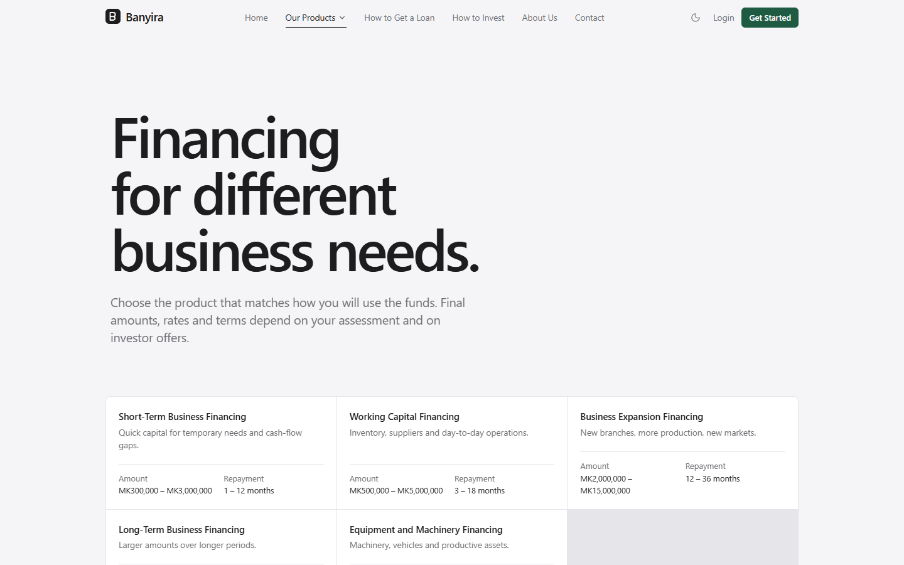 |
| **How to get a loan**<br>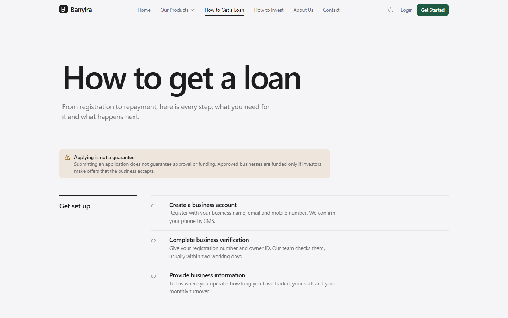 | **How to invest**<br>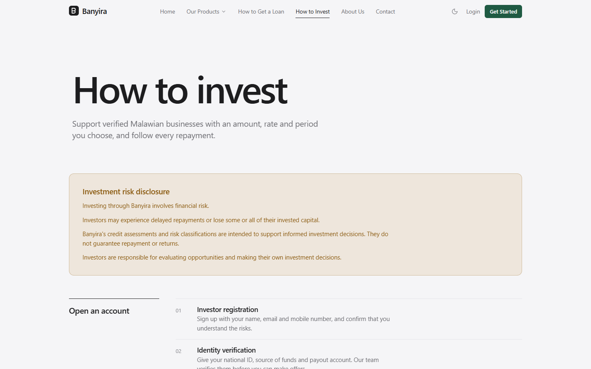 |
| **Get started (choose business or investor)**<br>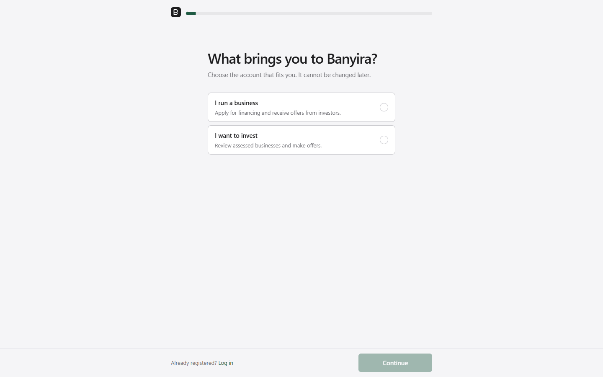 | **Home page on a phone**<br>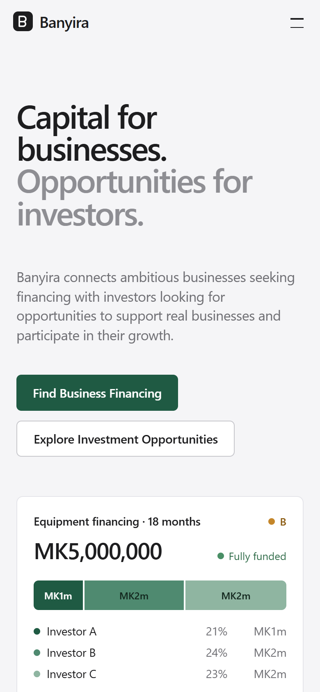 |

### Investor area

| | |
|---|---|
| **Portfolio overview**<br>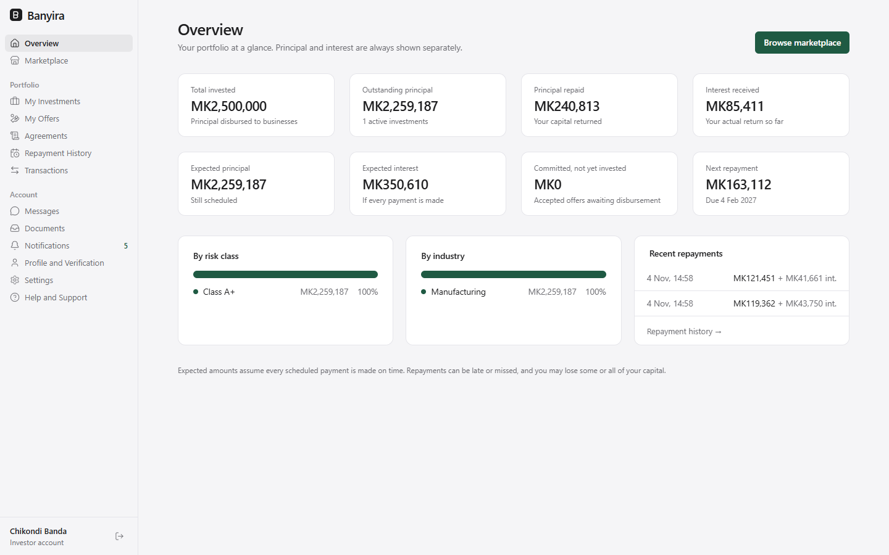 | **Marketplace of assessed businesses**<br>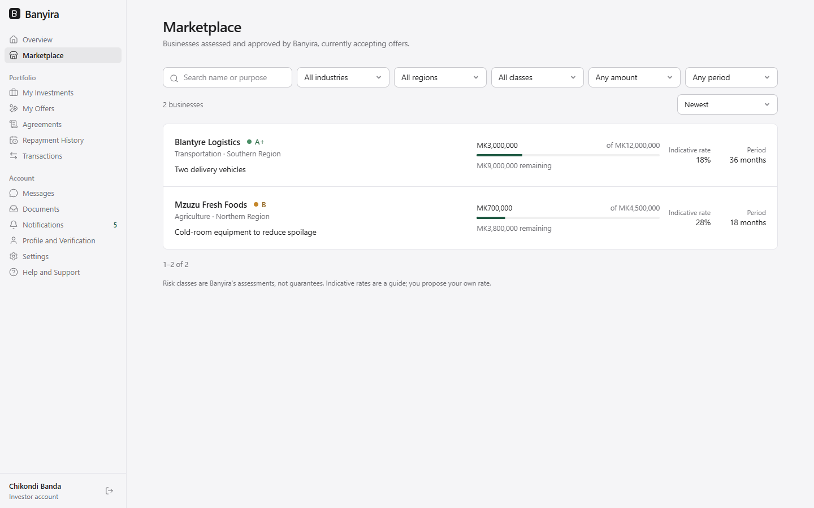 |
| **A business listing, where investors make offers**<br>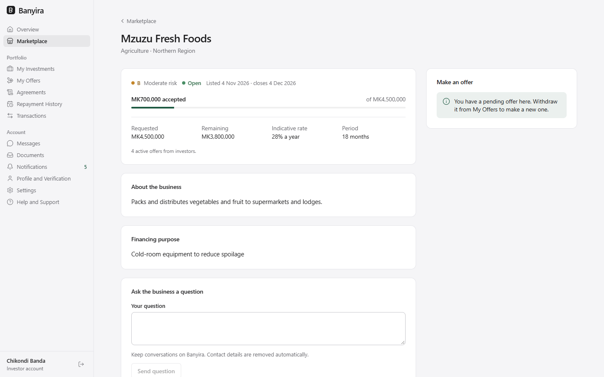 | |

### Business area

| | |
|---|---|
| **Business overview**<br>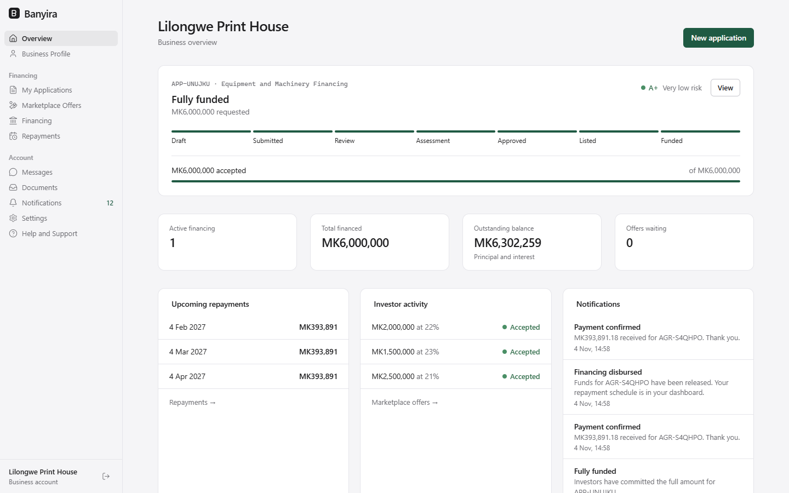 | **Offers from investors**<br>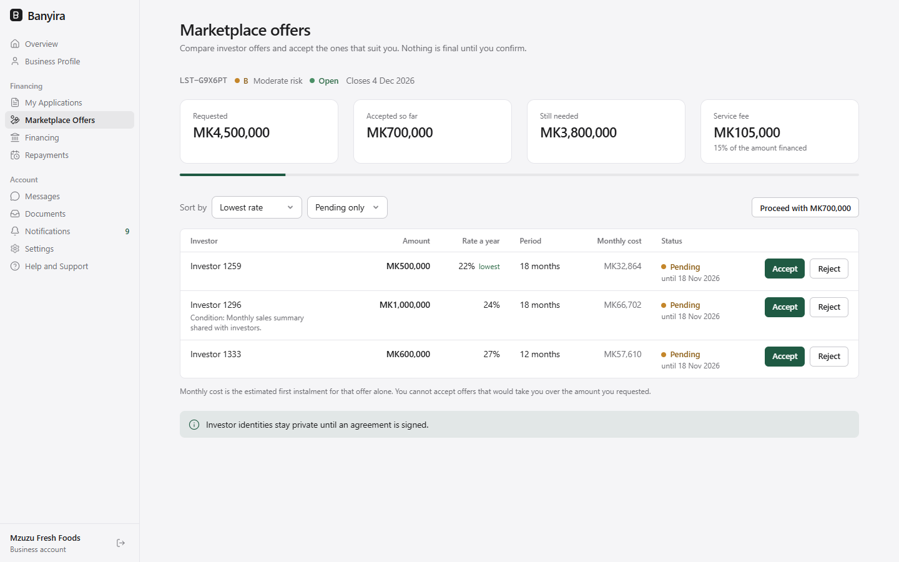 |
| **Repayment schedule**<br>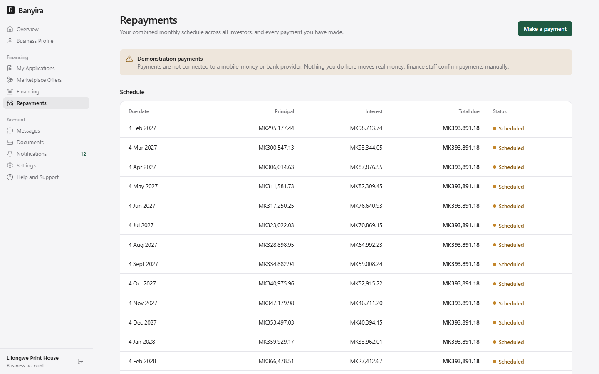 | |

---

## Who uses it

| User | What they do | Where |
|---|---|---|
| **Visitor** | Reads about products, fees, how to borrow and how to invest | Public site (`/`) |
| **Business** | Registers, applies for financing, uploads documents, reviews and accepts offers, signs the agreement, repays | `/business` |
| **Investor** | Verifies identity, browses assessed listings, makes offers, signs, funds, receives repayments | `/investor` |
| **Staff** | Credit, finance, sales, IT and executive teams run the platform | `/internal-access` (not linked publicly), MFA required |

## How financing flows

```
Apply → Assess → List → Offer → Choose → Agreement & signatures → Investor funds → Disburse → Repay
```

1. **Apply.** A business answers one question per screen, then completes an application with documents.
2. **Assess.** A credit officer scores the application against versioned, weighted criteria. The score maps to a risk class using the active rule bands. The person who assesses cannot also approve.
3. **List.** Approved businesses are published to the marketplace. Investors only ever see listing fields (`ListingResource`), never the private application.
4. **Offer.** Investors offer an amount, rate and term. Acceptance uses row locks, so a listing can never be overfunded. Offers can be withdrawn and expire automatically.
5. **Agreement.** The business accepts offers, then every party signs.
6. **Fund and disburse.** Finance confirms each investor's funds arrived in the client account. A disbursement needs two finance officers (maker-checker).
7. **Repay.** Repayments stay pending until confirmed (webhook or reconciliation). Each payment pays interest first, then principal, due date by due date. Shortfalls are shared pro rata between investors.

Every money movement is posted to a double-entry ledger that is balanced and immutable. Corrections are made by reversal, never by editing. Banyira's own money and client money are kept in separate account categories.

## Tech stack

- **Backend:** Laravel 13 (PHP 8.5), MySQL 8
- **Frontend:** Inertia v3, Vue 3 + TypeScript, Tailwind CSS v4, Lucide icons
- **Background work:** Laravel queue (SMS) and scheduler (rule activation, overdue flags, offer expiry, reminders)
- **Providers (swappable):** SMS (`log` in development), payments (`demo`, no real money), identity (manual review)

## Run it locally (Windows + Laragon)

Requires PHP 8.5, Composer, Node 20+, and MySQL 8 running (start Laragon with **Start All**).

```sh
composer install
npm install
cp .env.example .env
php artisan key:generate
php artisan migrate:fresh --seed     # creates tables, reference data and demo accounts (local only; wipes the database)
npm run build                        # or: npm run dev for hot reload
php artisan serve                    # http://localhost:8000
```

Optional, in separate terminals:

```sh
php artisan queue:work               # sends SMS jobs (written to the log in development)
php artisan schedule:work            # runs scheduled tasks every minute
```

The database is `banyira4` on `127.0.0.1` as `root` with no password. Tests use `banyira4_test`.

Demo accounts (business, investor and every staff role) are listed in [AGENTS.md](AGENTS.md). They are created by `DemoSeeder` and must never exist in production. Phone verification codes appear on the page in development.

## Checks

```sh
php artisan test          # feature tests (MySQL banyira4_test)
npm run typecheck         # vue-tsc
npm run build             # production assets
```

All three must pass before a change is finished.

## Project layout

```
app/
  Services/           Business rules. Controllers stay thin and delegate here.
    ApplicationWorkflow   the only place an application's status changes
    AssessmentService     weighted scoring, risk class, assessor ≠ approver
    MarketplaceService    offers, acceptance with row locks, withdrawal, expiry
    AgreementService      agreement → signatures → funding → disbursement → schedules
    PaymentService        pending → confirmed repayments, allocation, overdue
    LedgerService         double-entry, balanced, immutable
    ApprovalService       maker-checker for disbursements, expenses, payroll
    RulesService          fee tiers, interest ceiling, risk bands (versioned, effective-dated)
    AuditLogger           every status change, approval and sensitive view
  Support/Money.php   bcmath money maths and amortisation (never floats)
  Contracts/ + Services/{Sms,Payments,Identity}   provider abstractions
resources/
  css/app.css         design tokens (light + dark), type scale, motion
  js/Pages/           Inertia pages: Public, Auth, Business, Investor, Customer, Staff
  js/Layouts/         page shells (public site, dashboards, wizard, staff)
  js/Components/      shared UI (Btn, Card, DataTable, Modal, ThemeToggle …)
  js/lib/             shared logic (format, permissions, theme, wizard)
routes/               web routes; routes/console.php holds the schedule
database/seeders/     ReferenceDataSeeder (roles, permissions, rules) and DemoSeeder
tests/Feature/        feature tests
prototype/            earlier React prototype, reference only, not built
```

## Security and access

- Two login guards: `web` for customers and `staff` for employees. Staff sign in with MFA.
- Staff permissions are Gate abilities (`can:finance.approve`, `can:applications.assess` …), defined in `ReferenceDataSeeder::ROLES`.
- Every route is guarded on the server. Hiding a link in the UI is never the authorisation.
- Money is stored as `decimal(15,2)` and handled as strings; client-side maths is never trusted.

## Design

Calm, dense and trustworthy: system fonts, one forest-green accent, hairline borders, no gradients. Status is shown as a coloured dot plus text. Light and dark mode follow the device by default; visitors can choose Auto, Light or Dark from the public header, footer or mobile menu, and the choice is remembered. Motion honours the reduced-motion setting.

Planned design work is in [docs/REDESIGN_ROADMAP.md](docs/REDESIGN_ROADMAP.md). Engineering and design rules for contributors are in [AGENTS.md](AGENTS.md).
